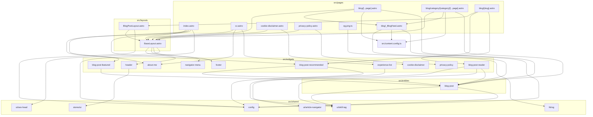

# Architecture

Target structure: Astro's conventions (ADR 002), imports flow `pages > layouts > components > lib` (ESLint enforced). The tree still holds the legacy folders `src/widgets`, `src/entities` and `src/shared`, which Story #76 moves. The map shows today's imports between folders; update it when a page, layout or component is added or removed.

## State
- Theme: `astro.config.mjs` injects `src/lib/theme.js` as a hashed inline `<head>` script on every page, so it costs no request (#86). A native store over localStorage key `theme` in `src/shared/stores/ui`, without a state library; it re-renders on the `storage` event from other tabs and on a bfcache `pageshow`. Only the `Header` client script reads and writes it. `src/lib/theme.js` applies a stored `light` or `dark` before first paint. Without one, nothing sets `data-theme` and `prefers-color-scheme` decides; the toggle's `aria-pressed` then follows the OS theme.
- Card-to-post morph: `astro.config.mjs` also injects `src/lib/post-morph.js` as a hashed inline `<head>` script, because its `pagereveal` listener must run before the first render. On `pageswap` and `pagereveal` it names the image and title of the clicked card (`[data-post-card]`) and of the post header (`#post-hero`, render-blocked with `<link rel="expect">` in `BlogPostLayout`) as `post-image` and `post-title`, then removes the names. Cross-document view transitions only; other engines navigate normally (#210).
- Menu: no JS store. State lives in the DOM: invoker commands (`commandfor`/`command`) open and close the modal `dialog#site-menu`, and its only script closes it on `pagehide` so Back restores it closed. Blog categories: no client state; each category is a static page built by `getStaticPaths`, linked from `nav[aria-label="Blog categories"]` with `aria-current="page"` on the current link. `/blog/` and each category page are split at 10 posts by `paginate()`: page 1 at the base URL, then `2/`, linked from `nav[aria-label="Pagination"]` (#160).
