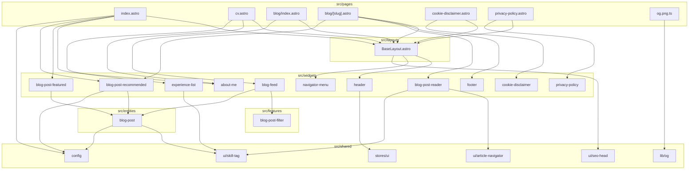

# Architecture

Target structure: Astro's conventions (ADR 002), imports flow `pages > layouts > components > lib` (ESLint enforced). The tree still holds the legacy folders `src/widgets`, `src/features`, `src/entities` and `src/shared`, which Story #76 moves. The map shows today's imports between folders; update it when a page, layout or component is added or removed.

## State
- Theme: `BaseLayout` loads `public/theme.js` once per page. `themeStore` (`@nanostores/persistent`, localStorage key `theme`) in `src/shared/stores/ui`. Only the `Header` client script reads and writes it. `public/theme.js` applies the stored theme before first paint.
- Menu and blog filter: no JS store. State lives in the DOM (form controls, `hidden` attributes).
