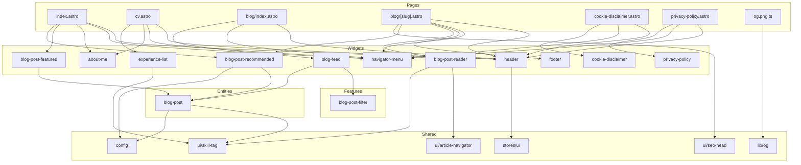

# Architecture

Feature-Sliced Design: `pages > widgets > features > entities > shared`. A layer imports only from layers below it (ESLint enforced). The map shows cross-slice imports; update it when a slice or page is added or removed.

## State
- Theme: `themeStore` (`@nanostores/persistent`, localStorage key `theme`) in `src/shared/stores/ui`. Only the `Header` client script reads and writes it. `public/theme.js` applies the stored theme before first paint.
- Menu and blog filter: no JS store. State lives in the DOM (form controls, `hidden` attributes).
