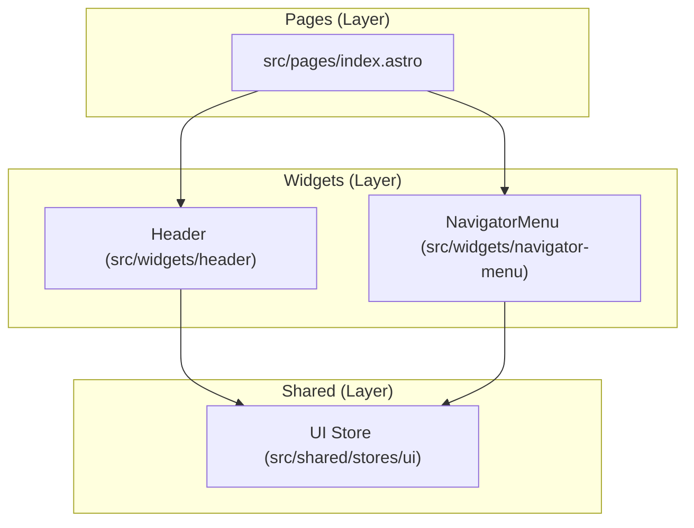

# Architecture Visualization

This document provides a living visualization of the repository's feature-sliced design (FSD) architecture and component hierarchy.

## Component Tree

## State Management

- **UI Store (`isMenuOpen`, `themeStore`)**: Managed via Nano Stores in `src/shared/stores/ui`. Both `Header` and `NavigatorMenu` subscribe to this store to handle their layout and visual state reactively across Astro Islands.
