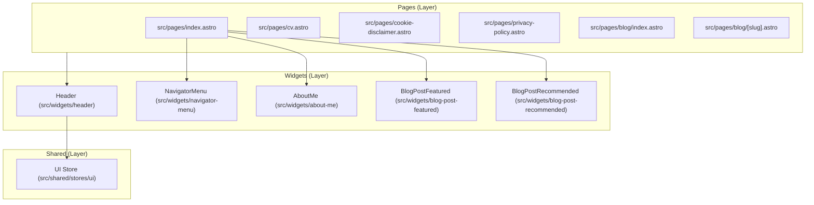

# Architecture Visualization

This document provides a living visualization of the repository's feature-sliced design (FSD) architecture and component hierarchy.

## Component Tree

## State Management

- **UI Store (`themeStore`)**: Managed via Nano Stores in `src/shared/stores/ui`. Only the `Header` reads this store to handle visual state reactively across Astro Islands.
