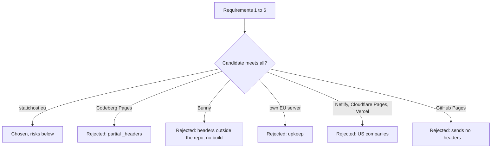

# ADR 001: Framework Migration (web components -> Astro, static hosting)

## Context
The legacy site was a web-components repo: every component was a custom element with its own script and styles, meant to ship as a separate package.

The host for the static output must meet six requirements:
1. EU company and infrastructure (owner preference).
2. Serves `public/_headers` unchanged: CSP `frame-ancestors`, HSTS, nosniff, COOP/COEP/CORP and the `/_astro/*` cache rule.
3. Custom domain with automatic HTTPS.
4. Builds on the host from the repo, so deploys need no CI job or upload step.
5. Password-protected staging on the same host as production.
6. Free or low cost, with no server to maintain.

## Decision
Migrate to **Astro** with `output: 'static'`: pure static HTML. The code follows Astro's conventions, not the legacy component breakdown (ADR 002).

Host on **statichost.eu**, Hobby plan (free: 1 site, 100 build minutes, 10 GB bandwidth, custom headers and password protection on all plans). `www.pa-tech.dev` is canonical, with a 301 from the apex. Stockholm-based, and states that every layer from git deploy to CDN runs on European infrastructure owned by European companies.

- Build: `statichost.yml` in the repo root (`node:26`, Corepack installed with npm, `pnpm install --frozen-lockfile`, `pnpm build`, public `dist`). The dashboard pnpm preset runs `corepack enable`, which Node.js no longer ships from 25.0.0.
- Headers: `public/_headers`, verified live by `pnpm test:e2e:staging`. The site-wide block and the `/_astro/*` wildcard are both served exactly on Hobby.
- Staging: HTTP Basic Auth set in the dashboard. Authenticated responses carry the `_headers` values unchanged; the 401 carries only the host's own headers and no page content.

## Alternatives
| Host | Fails | Evidence |
|---|---|---|
| Codeberg Pages | 2 | `_headers` supports only Access-Control-Allow-Origin, Access-Control-Expose-Headers, Content-Security-Policy, Content-Type, Permissions-Policy, Referrer-Policy, X-Frame-Options and X-Clacks-Overhead: no HSTS, nosniff, COOP/COEP/CORP or Cache-Control. |
| Bunny Storage + CDN | 2, 4 | Response headers come from Edge Rules set in the dashboard, not a repo file; sites are built locally and uploaded; $1 monthly minimum. |
| Own EU server | 6 | Full control, but OS patches, TLS renewal and monitoring become the owner's job. |
| Netlify | 1 | Reads `_headers`, but headquartered in San Francisco. |
| Cloudflare Pages | 1 | Reads `_headers`, but headquartered in San Francisco. |
| Vercel | 1, 2 | US company (Covina, CA); custom headers are set in `vercel.json`, not `_headers`. |
| GitHub Pages | 2, 5 | Sends none of the `_headers` (checked with `curl -I` on a live Pages site); a project site needs `base: '/<repo>'`, a different build than production; Pages sites are public. |

## Consequences
- **Positive:** Near-zero attack surface: static files, no server code.
- **Positive:** Server-rendered HTML with zero JavaScript by default, so good Lighthouse and SEO results for the blog (staging baseline: performance 100, LCP 0.8 s mobile).
- **Positive:** Full control over vanilla CSS without utility-class bloat.
- **Positive:** Low exit cost: the output is static files, and `_headers` is the format Netlify and Cloudflare Pages also read.
- **Negative:** Open Graph images need a build step (`Satori` in Astro).
- **Negative:** Small operator: a named founder and a Stockholm address, but no legal entity named on the homepage.
- **Negative:** The docs list path and wildcard header rules as "depending on plan" and do not document pnpm; both are covered by `statichost.yml` and the staging spec, which fail if the host changes behavior.
- **Negative:** Hobby allows one site, so the staging site becomes production when the domain moves (#168).
- **Negative:** The dashboard can report an error for a change it applied (a 504 on enabling password protection), so settings are verified from outside, not from the dashboard response.

Sources (read 2026-10-12):
- https://www.statichost.eu/
- https://www.statichost.eu/pricing/
- https://www.statichost.eu/docs/build-config/
- https://www.statichost.eu/docs/custom-headers/
- https://www.statichost.eu/docs/password-protection/
- https://github.com/nodejs/corepack
- https://docs.codeberg.org/codeberg-pages/advanced-usage/
- https://bunny.net/pricing/
- https://bunny.net/docs/cdn/edge-rules/index.md
- https://bunny.net/docs/storage/static-site-hosting/index.md
- https://docs.netlify.com/manage/routing/headers/
- https://www.netlify.com/about/
- https://developers.cloudflare.com/pages/configuration/headers/
- https://www.cloudflare.com/about-overview/
- https://vercel.com/docs/headers
- https://vercel.com/legal/privacy-policy
