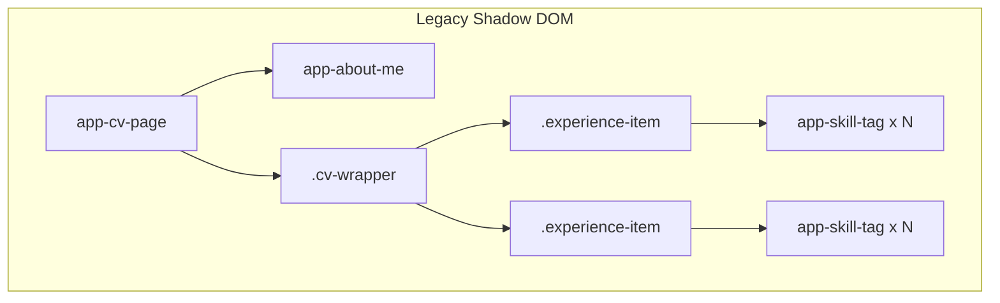

# CV Page - Pathology & De-entanglement Report

## 1. Current Legacy Entanglements

The legacy `cv-page` is a Hybrids.js web component (`app-cv-page`). It acts as a full-page layout orchestrator rather than a granular component.

### Pathologies:
1. **Hybrids.js Lifecycle:** It imports `define` and `html` from `hybrids`, but defines no reactive properties or lifecycle hooks. It is a pure render function trapped in a web component container.
2. **Coupled CSS:** Layout logic (the 2-column grid on desktop vs flex column on mobile) is hardcoded inside the web component's string literal CSS.
3. **Implicit Dependency:** Relies on global CSS variables (`--theme-primary`, `--font-color`, `--font-color-bold`) and a user preference media query (`prefers-color-scheme`) instead of the explicit Nano Store theme toggle system implemented in the new Astro architecture.
4. **Hardcoded Positioning:** The `<app-about-me>` component uses `position: fixed; top: 8.55rem;` which assumes a globally fixed header of a specific size, making it brittle to layout changes.

## 2. Decoupling Strategy

- **Architectural Shift:** Move from a client-side Web Component to a static `src/pages/cv.astro` route.
- **Dependency Migration:** We will import the already migrated FSD components (`AboutMe.astro` and `SkillTag.astro`).
- **CSS Extraction:** The template literal CSS will be migrated to Astro's scoped `<style>` blocks. Theme support will be handled via the established global theme CSS variables in `src/shared/styles/global.css`.
- **Zero-JS Requirement:** Because this page contains purely static text and links (including the CV download link), it will ship with **zero client-side JavaScript**.
