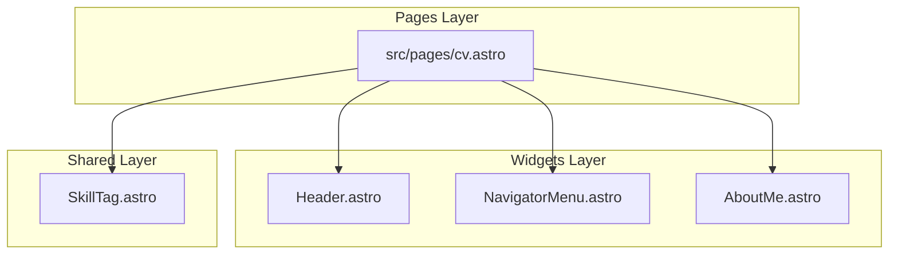

# Spec: CV Page (`pages/cv.astro`)

## 1. Functional Requirements

The CV Page acts as a static layout providing the user's resume, work experience, and a PDF download link.

- It must compose the `Header` and `NavigatorMenu` components.
- It must render the `AboutMe` widget as a sidebar.
- It must render a list of experience items detailing roles, responsibilities, and associated skills.
- It must render the `SkillTag` shared UI component for each listed skill.
- It must provide a download link to `patrik-alexits-cv.pdf` using standard HTML5 download attributes.

## 2. Decoupled Architecture

## 3. Styling Rules
- **CSS Grid/Flexbox:** Use standard Flexbox (mobile) and Grid/Flex (desktop) for structural layout.
- **Dark/Light Mode:** Inherit global CSS variables from `src/shared/styles/global.css` (e.g., `var(--font-color)`, `var(--theme-primary)`). Remove the legacy hardcoded `(prefers-color-scheme)` queries and replace them with standard `.theme-dark` / `.theme-light` variables or rely completely on the global tokens.
