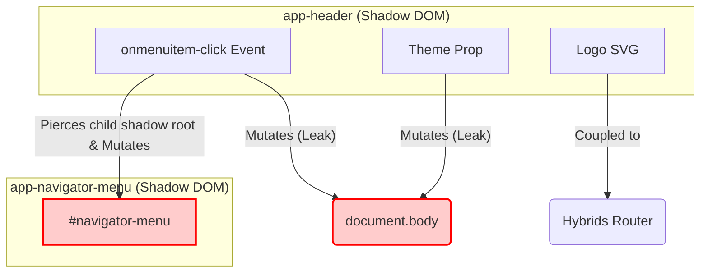

# Pathology Report: Legacy Header Component

## 1. Analysis of `header.ts`
The legacy `header.ts` component is highly entangled, breaking several core Web Component and architectural principles. A 1:1 migration is impossible and would port over significant technical debt.

### Identified Entanglements:
1. **Shadow DOM Piercing (Severe Encapsulation Breach):**
   The header reaches into its own shadow root, finds a child component (`<app-navigator-menu>`), and then violently pierces the child's shadow root to manually toggle an `open` class on a deeply nested element (`#navigator-menu`).
2. **Global State Mutation Leak:**
   Despite being a scoped web component, it reaches outside its boundaries to mutate `document.body.style.overflowY = "hidden"` and `document.body.setAttribute('data-theme')`.
3. **Hybrids.js Router Coupling:**
   The component is tightly coupled to `hybrids/router` (`router.url(Home)`), meaning it isn't a dumb presentation component—it is aware of the global routing tree.
4. **CSS `:host` Dependency:**
   The styling relies on `:host`, meaning it expects to exist within a Shadow Root. Astro components are Server-Side Rendered (SSR) flat HTML by default and do not use Shadow DOM.

## 2. Mermaid Visualization of Current Entanglement

## 3. Decoupling Strategy for Astro

1. **Eliminate Shadow DOM:** Astro components are server-rendered. We will drop `:host` and replace it with standard semantic HTML (`<header class="app-header">`). Astro automatically scopes the CSS to the component natively without the shadow boundary.
2. **State Hoisting (Astro Nano Stores or Signals):** Instead of the Header reaching into the Navigator Menu, we will use a global UI state atom (e.g., `isMenuOpen`). The Header emits an event or toggles the store; the Navigator Menu listens to the store and updates itself.
3. **Theme Management Migration:** The `getColorScheme` logic will be moved to a lightweight `<script is:inline>` in the `<head>` of the base layout to prevent CSS flashing on initial load, completely removing it from the Header's logic.
