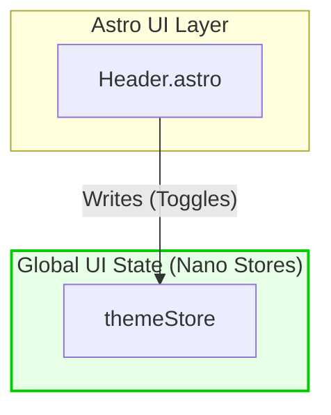

# Spec: Decoupled App Header

## 1. Functional Requirements
The `<Header />` component is a pure presentational and highly decoupled Astro layout element. 
- It must render the primary logo linked to the home route.
- It must render a Theme Toggle button (Dark/Light).
- It must render the trigger for the Navigator Menu (a `<button>` using Invoker Commands or a lightweight JS fallback to open a `<dialog>`).
- **Strict Decoupling:** It must *not* manage the internal state or visibility of the Navigator Menu directly via JS stores. It relies on native DOM APIs (`dialog`) for menu coordination.

## 2. Decoupled Architecture (Astro + Nano Stores)
We will use Nano Stores (`nanostores`) for framework-agnostic, microscopic global state (currently just for theme).

## 3. CSS Migration (Pristine Visuals)
The legacy CSS will be imported directly into the `<style>` block of `Header.astro`. The `:host` selector will be mapped to a `.header-wrapper` class to retain visual parity while dropping the Shadow DOM.
