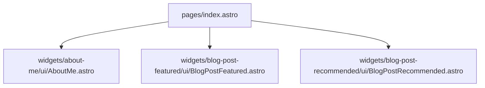

# Spec: Home Page (`pages/index.astro`)

## Architecture
The legacy `<app-home>` component is a layout composing the `AboutMe`, `BlogPostFeatured`, and `BlogPostRecommended` widgets.

## CSS Decoupling
The legacy `home.ts` uses flexbox and a CSS grid for responsiveness:
- Mobile: flex column with gap `3rem`.
- Desktop (`>= 768px`): grid with 2 columns.
We will use native CSS Grid and Flexbox directly in `pages/index.astro` scoped styles.

## Stubs
Since `BlogPostFeatured` and `BlogPostRecommended` depend on a full blog content layer which does not yet exist, we will implement them as stubs with the necessary semantic HTML and IDs (`#blog-featured` and `#blog-section`) to satisfy the legacy visual structure.
