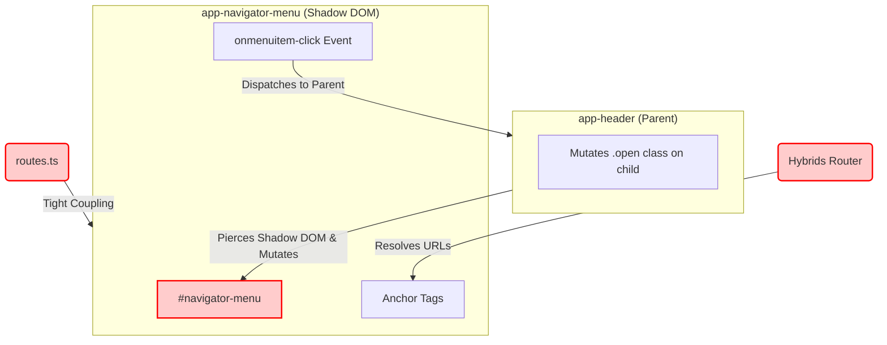

# Pathology Report: Legacy Navigator Menu Component

## 1. Analysis of `navigator-menu.ts`
The legacy `navigator-menu.ts` component is a Web Component built with `hybrids.js`. It contains significant entanglements and anti-patterns that need decoupling before migrating to Astro.

### Identified Entanglements:
1. **Hybrids Router Coupling:**
   The component relies heavily on `hybrids/router` (`router.url(item.routeComponent)`). It imports a global `routes` configuration to render the links, violating strict component isolation. The UI component should only accept a list of plain link objects, rather than resolving the router paths directly.
2. **Shadow DOM & External Mutation Target:**
   As discovered in the `header.ts` pathology, the parent `Header` component forcefully reaches into this component's shadow root to toggle an `open` class on `section#navigator-menu`. The component itself has no internal state management for its open/closed state; it purely acts as a dumb DOM target for the parent's mutations.
3. **Event Dispatching Leak (Custom Events):**
   The component blindly dispatches a custom `menuitem-click` event to its host whenever a link or the opener is clicked, expecting an external parent to handle the state toggle and document styling changes.
4. **CSS `:host` Dependency:**
   Styling heavily depends on `:host` and targets `#navigator-menu` using the `open` class (which is externally mutated). This needs to be decoupled from the Shadow DOM paradigm.

## 2. Mermaid Visualization of Current Entanglement

## 3. Decoupling Strategy for Astro

1. **Eliminate Shadow DOM & Hybrids Router:** We will convert this into a pure Astro component. Routing will be handled by standard `href` paths instead of a client-side router utility. The list of links can be passed as standard props or defined internally if they are static site-wide routes.
2. **State Integration (Nano Stores):** We will connect this component to the existing `isMenuOpen` Nano Store (created during the Header migration). Instead of waiting for a parent to mutate its DOM, the menu will reactively bind its visibility to the store using vanilla JS inside Astro.
3. **Semantic CSS & Accessibility:** Replace the custom event dispatches with a clean client-side event listener that toggles the `isMenuOpen` store. The component's styles will be scoped natively by Astro.
