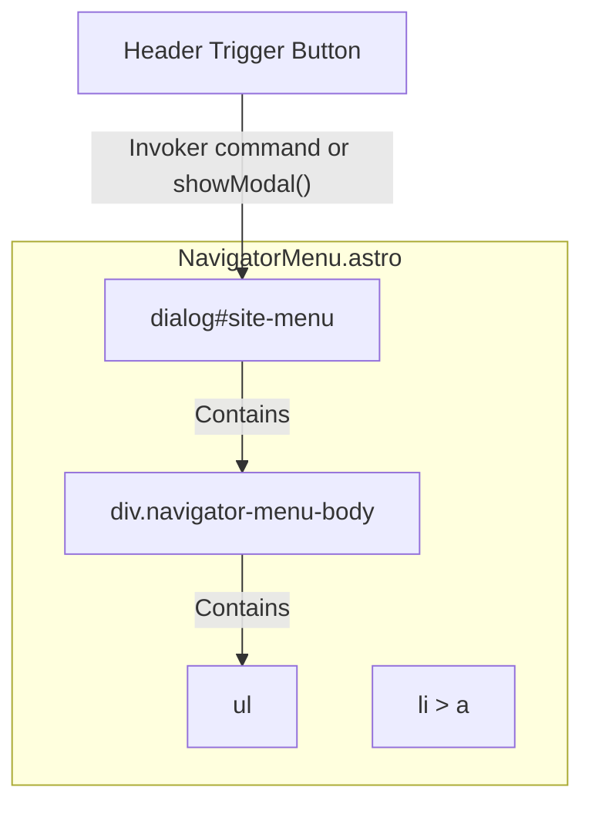

# Navigator Menu Component Specification

## Overview
The `NavigatorMenu` component is a full-screen overlay menu that displays the primary navigation links of the site. It is built as a native `<dialog>` element, removing reliance on JavaScript state stores for visibility.

## DOM Tree & Architecture

## Props / Configuration
- **menuItems**: An array of `RouteModel` or simple objects containing `name` and `path` for each link. If not provided via props, it will fallback to a default set of links (`Home`, `Blog`, `CV`, etc.).

## Behavior
- The menu is built on a native HTML `<dialog id="site-menu" closedby="closerequest">`.
- It sits natively hidden in the DOM until triggered to open.
- Once open, it serves as a modal overlay with the list of links.
- Esc key closes it natively; clicks on links close it natively (either through default navigation or a close handler/invoker command).
- No JS state store (`isMenuOpen`) is required for toggling visibility.
