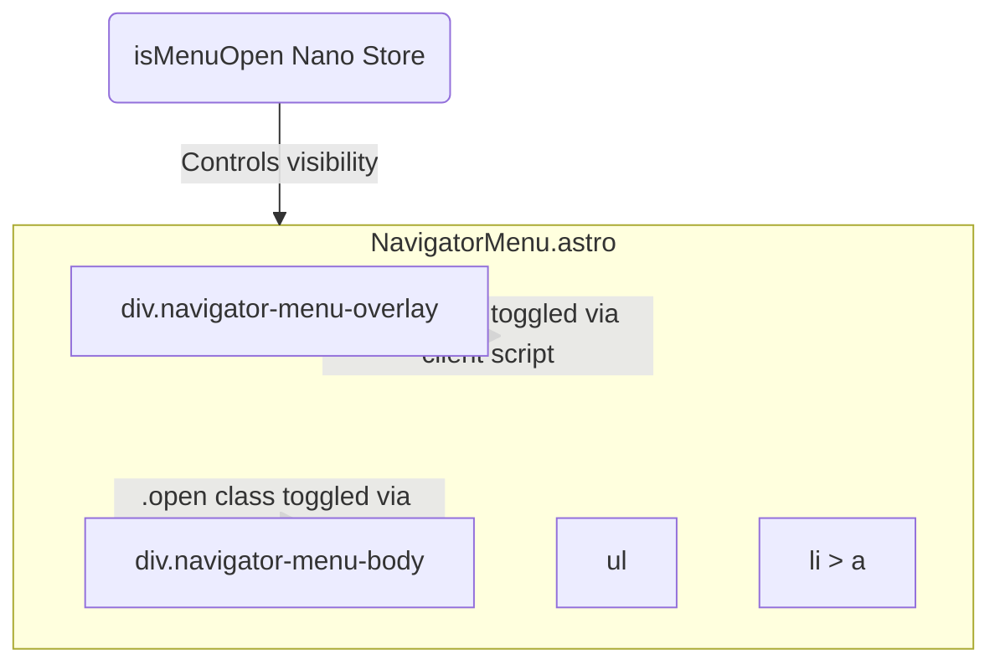

# Navigator Menu Component Specification

## Overview
The `NavigatorMenu` component is a full-screen overlay menu that displays the primary navigation links of the site. It replaces the legacy `app-navigator-menu` web component, removing its reliance on the shadow DOM and Hybrids.js router.

## DOM Tree & Architecture

## Props / Configuration
- **menuItems**: An array of `RouteModel` or simple objects containing `name` and `path` for each link. If not provided via props, it will fallback to a default set of links (`Home`, `Blog`, `CV`, etc.).

## Behavior
- The menu sits invisibly in the DOM until the `isMenuOpen` store is toggled to `true`.
- Once open, a blurred overlay and the list of links appear.
- Clicking any link within the menu will automatically toggle `isMenuOpen` back to `false` and navigate to the selected route.
- The component must be accessible (e.g., hidden from screen readers when closed, trap focus when open).
